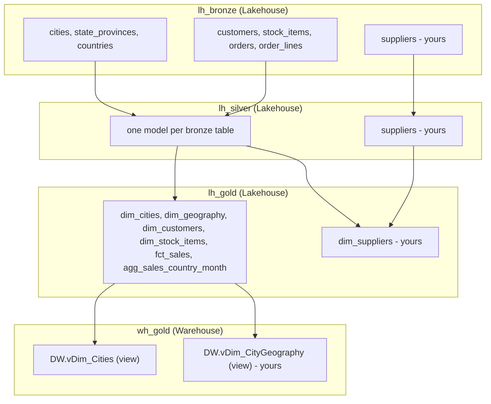

# DP Project Training

[Home](../../index.md) > [Training](../index.md) > DP Project

The DP (Data Platform) training scenario uses a **geography dataset** — cities, countries, and state/provinces — to guide you through a complete Microsoft Fabric data platform, from raw ingestion to analytics.

## The Dataset

The sample project ships a small sales dataset, generated deterministically by its DDL scripts,
and the same transformation to silver and gold run four ways (see the
[sample project walkthrough](../../examples/sample_project.md)). The training adds one entity of
its own, **suppliers**, and carries it through every layer so your work stays separate from the
sample's.

| Table | Layer | Description |
|-------|-------|-------------|
| `cities`, `state_provinces`, `countries` | Bronze | the geography (sample) |
| `customers`, `stock_items`, `orders`, `order_lines` | Bronze | the sales data, about 150,000 order lines (sample) |
| `suppliers` | Bronze | **yours**, Exercise 2 |
| one model per bronze table | Silver | an incremental merge of each bronze table on its key (sample); `suppliers` is yours, Exercise 3, with the CDC filter that keeps current records only |
| `dim_cities`, `dim_geography`, `dim_customers`, `dim_stock_items`, `fct_sales`, `agg_sales_country_month` | Gold | the sample's dimensions and facts |
| `dim_suppliers` | Gold | **yours**, Exercise 4: a supplier with the geography of its delivery city |
| `DW.vDim_Cities` | Warehouse | view over `dim_cities` (sample) |
| `DW.vDim_CityGeography` | Warehouse | view over `dim_geography`, **yours**, Exercise 4; Exercises 5 to 7 build on both views |

## Architecture



## Project Structure

When you run `ingen_fab init new --with-samples`, you get:

```
your-project/
├── ddl_scripts/
│   ├── Lakehouses/
│   │   ├── lh_bronze/001_Initial_Creation/   ← cities, countries bootstrap scripts
│   │   ├── lh_bronze/002_Change/             ← schema evolution example
│   │   ├── lh_bronze/003_Sales_Demo_Data/    ← state_provinces, more cities, customers, stock items, orders
│   │   ├── lh_silver/001_Initial_Creation/   ← 2 transformation scripts
│   │   └── lh_gold/001_Initial_Creation/     ← 1 dimension script
│   └── Warehouses/
│       └── wh_gold/001_Initial_Creation/     ← schema + view scripts
├── dbt_project/
│   └── models/
│       ├── silver/  ← 7 models, one per bronze table
│       └── gold/    ← 6 models (dim_cities, dim_geography, dim_customers, dim_stock_items, fct_sales, agg_sales_country_month)
├── dbt_warehouse/   ← the same models in T-SQL for the warehouse path
├── fabric_config/
│   └── storage_config.yaml
└── fabric_workspace_items/
    ├── config/var_lib.VariableLibrary/
    ├── notebooks/   ← dbtload_lakehouse, dbtload_warehouse (generated)
    └── dbt_jobs/    ← dbtjob_warehouse (the Fabric dbt job item)
```

## Exercises

Work through the exercises in order:

0. **[Exercise 0 — Environment Setup](exercise-00-prerequisites.md)**  
   Set up your Python environment, install `ingen_fab`, and confirm your Fabric workspace is ready.

1. **[Exercise 1 — Project Setup](exercise-01-project-setup.md)** ⭐  
   Initialise the DP project, compile DDL notebooks, deploy to Fabric, and verify the bronze tables are populated.

2. **[Exercise 2 — New Bronze Table](exercise-02-bronze-table.md)** ⭐  
   Write a bronze DDL script for `suppliers` from scratch and deploy it.

3. **[Exercise 3 — Silver Transformation](exercise-03-silver-transformation.md)** ⭐⭐  
   Transform `suppliers` from bronze to silver with a dbt model and register its source.

4. **[Exercise 4 — Gold Layer](exercise-04-gold-layer.md)** ⭐⭐  
   Build `dim_suppliers`, a gold dimension that joins suppliers to the sample's geography, and the warehouse view Exercise 5 needs.

5. **[Exercise 5 — Semantic Model](exercise-05-semantic-model.md)** ⭐⭐  
   Create a Fabric semantic model over the `wh_gold` warehouse views.

6. **[Exercise 6 — Power BI Report](exercise-06-report.md)** ⭐⭐  
   Build a Power BI report from the semantic model.

7. **[Exercise 7 — GraphQL API](exercise-07-graphql.md)** ⭐⭐⭐ *(Stretch)*  
   Expose `wh_gold` data via a Fabric GraphQL API.

---

!!! info "Ready to begin?"
    Start with [Exercise 0 — Prerequisites](exercise-00-prerequisites.md).
